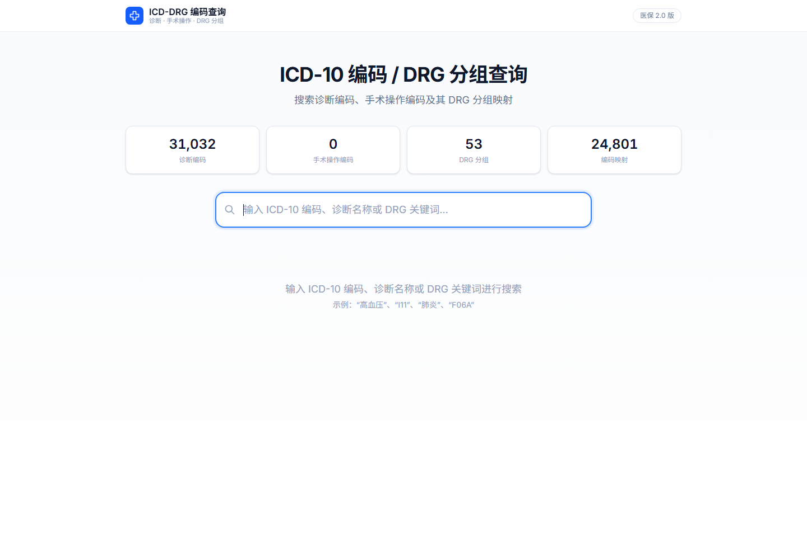
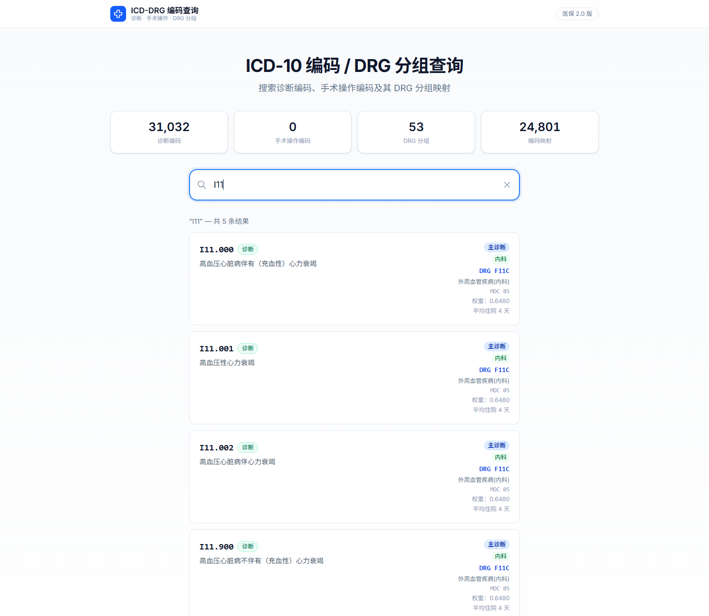

# ICD-10 / DRG 编码查询

面向医保 DRG 付费场景的**双向检索**小工具：输入 ICD-10 诊断编码、中文诊断名，或 DRG 分组代码，即可查回对应的 DRG 分组、MDC、相对权重（RW）、平均住院日（GMLOS）以及 ICD ↔ DRG 的映射关系。

Next.js 16 · React 19 · TypeScript · Tailwind CSS 4 · SQLite (better-sqlite3) / PostgreSQL (Supabase)



## 功能

- **双向检索**：ICD 侧（编码 / 中文名 → 关联 DRG）与 DRG 侧（DRG 代码 / 描述 → 关联 ICD）并行查询，结果按 `icd_code|drg_code|role` 复合键去重合并，单次上限 50 条。
- **查询意图识别**：正则区分「编码」与「中文描述」，编码走 `LIKE 'I11%'` 前缀匹配，中文走 `LIKE '%高血压%'` 模糊匹配，一套接口两种语义。
- **可分享链接**：搜索结果会写入 `?q=`，`/?q=I11` 可直接打开对应查询。
- **交互细节**：350ms 输入防抖、空串短路不发请求、骨架屏、错误一键重试、`/` 快捷键聚焦搜索框。
- **实时统计**：`/api/stats` 展示库内编码、DRG 分组与映射总量。



## 数据规模

| 数据 | 条数 |
| --- | --- |
| ICD-10 诊断编码 | 31,032 |
| DRG 分组 | 53 |
| ICD ↔ DRG 映射 | 24,801 |

数据随仓库以 `data.db`（SQLite）形式提供，克隆后无需额外准备即可运行。

## 技术实现

**请求链路**

```
SearchBox (300ms 防抖)
  → GET /api/search?q=...&type=...
    → executeSearch()          // lib/search-local.ts | lib/search.ts
      → SQLite: 前缀/模糊查询 + json_group_array 聚合嵌套映射
      → Supabase: 关系嵌入查询 icd_drg_mappings(drg_groups(...))
    → 扁平化 + 复合键去重 + 上限 50
  → ResultCard 渲染（诊断/手术、内科/外科、主诊断/CC/MCC 徽章）
```

**几个实现取舍**

1. **双数据源适配层**：`lib/search.ts`（Supabase）与 `lib/search-local.ts`（SQLite）暴露同名同签名的 `executeSearch(query, type)`，路由层改一行 import 即可切换，本地开发与云端部署共用同一套前端与 API。
2. **一次请求取回嵌套数据**：SQLite 侧用 `LEFT JOIN` + `json_group_array` 在单条 SQL 内聚合「ICD + 其全部 DRG 映射」，避免 N+1 查询；Supabase 侧用关系嵌入达到同样效果。
3. **搜索安全**：`LIKE` 通配符转义（`ESCAPE '!'`）、查询长度上限 200 字符、`type` 参数白名单校验。
4. **服务端 / 客户端边界**：页面骨架为服务端组件，仅搜索交互部分是客户端组件，首屏无需等待 JS。
5. **Serverless 适配**：部署到只读文件系统的平台时，`better-sqlite3` 会把随包分发的 `data.db` 复制到临时目录再以 WAL 模式打开（见 `lib/sqlite-db.ts`），并用 `outputFileTracingIncludes` 确保 DB 文件被打进产物。

## 本地运行

```bash
npm install
npm run dev      # http://localhost:3000
```

生产构建：

```bash
npm run build && npm start
```

## 目录结构

```
app/
  api/search/route.ts     # 检索接口（参数校验 + 错误兜底）
  api/stats/route.ts      # 数据量统计
  components/             # SearchPage / SearchBox / ResultCard / StatsBar
lib/
  search-local.ts         # SQLite 检索实现
  search.ts               # Supabase 检索实现
  sqlite-db.ts            # 连接管理（含 Serverless 适配）
  types.ts
data.db                   # 内置数据集（SQLite）
scripts / *.cjs           # 数据管线：PDF 抽取 → 解析 → 入库 → DRG 分组生成
supabase/ mysql/          # 另一套 schema 与 seed（PostgreSQL）
```

## 数据来源与免责声明

- ICD-10 编码来自《医保 2.0 版》ICD-10 目录 PDF，经自写的 PDF 抽取 + 正则解析管线清洗入库，解析规则对跨行诊断名、页眉页脚、扩展码后缀做了处理，仍可能存在个别边角错误。
- **DRG 分组与 ICD→DRG 映射为按公开 CN-DRG 规则自行整理生成的示例数据**，不是官方分组器输出，也不构成完整 ADRG/DRG 目录。
- 本项目用于工程能力演示，**不可用于临床诊疗、医保结算或任何实际付费决策**。真实场景请以国家/地方医保局发布的最新版本与官方分组器为准。

## License

MIT（数据部分请以官方发布版本为准）